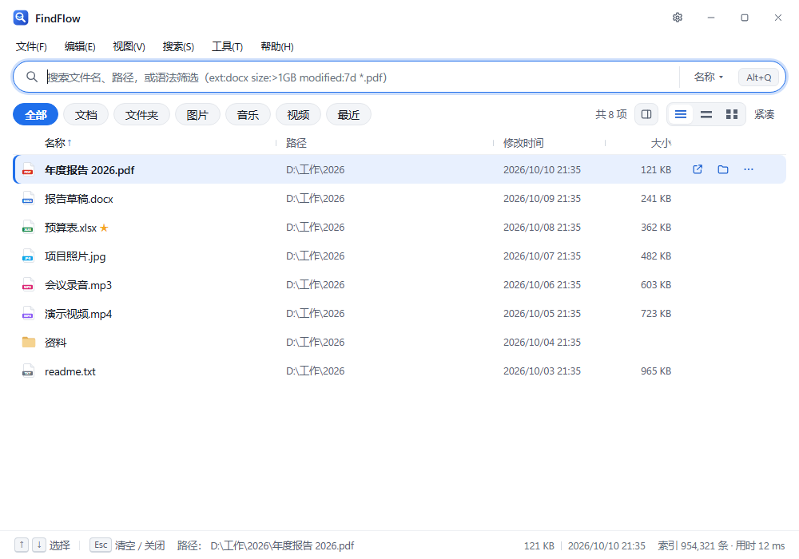
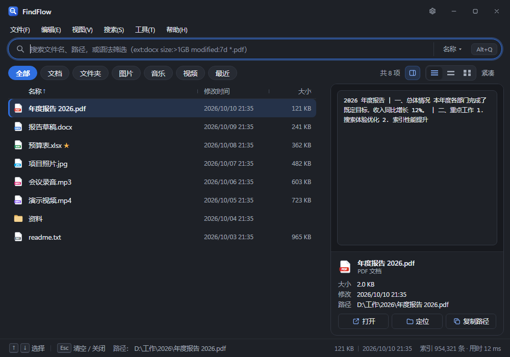
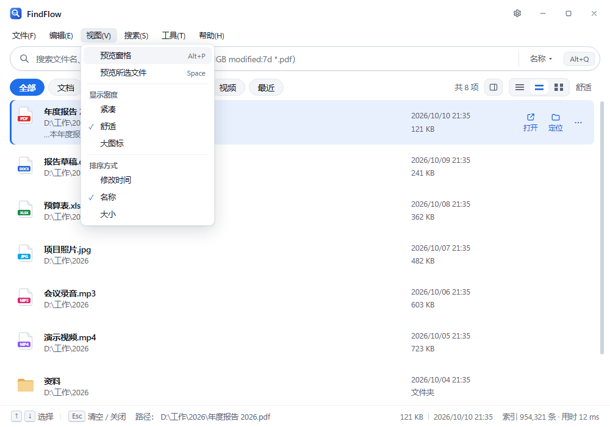

# FindFlow

Windows 本地优先的极速文件搜索与轻量文件处理工具。全局快捷键（默认 Alt + Q）呼出紧凑悬浮窗，在不打断当前工作的前提下完成查找、筛选、预览、定位与常用文件操作——把「找到文件到完成动作」压缩到数秒以内。

> **当前版本**：v0.8.1（2026-10-10）。安装包见 [Releases](../../releases)，版本变更见 [`CHANGELOG.md`](CHANGELOG.md)。
> 本项目以 [MIT](LICENSE) 许可证发布，第三方组件见 [`THIRD-PARTY-NOTICES.md`](THIRD-PARTY-NOTICES.md)。

## 目录

- [下载与安装](#下载与安装)
- [核心能力](#核心能力)
- [界面预览](#界面预览)
- [快速上手](#快速上手)
- [搜索语法](#搜索语法)
- [快捷键](#快捷键)
- [索引说明](#索引说明)
- [性能](#性能)
- [常见问题](#常见问题)
- [开发](#开发)
- [安全与隐私](#安全与隐私)

## 下载与安装

| 文件 | 说明 |
| --- | --- |
| `FindFlow-vX.Y.Z-win-x64-setup.exe` | NSIS 安装包（推荐），当前用户安装，无需管理员权限 |
| `FindFlow-vX.Y.Z-win-x64.msi` | MSI 安装包，便于企业分发 |
| `SHA256SUMS.txt` | 两个安装包的 SHA-256 校验值 |
| `FindFlow-vX.Y.Z-win-x64-setup.exe.sig`、`latest.json` | 更新签名与更新清单（供应用内更新机制使用） |

- **系统要求**：Windows 10 22H2 / Windows 11（x64），需要 WebView2 Evergreen Runtime（Windows 11 自带）。
- **安装界面**：简体中文。安装后「设置 → 应用」卸载列表中的名称带版本号（如 `FindFlow v0.8.1`）。
- **升级**：直接运行新版安装包覆盖安装，索引与设置保留。目前应用内没有「检查更新」入口，需要手动下载新版本。
- **首次运行提示**：安装包只有更新签名、没有 Windows 代码签名证书，首次运行时 SmartScreen 可能提示「Windows 已保护你的电脑」，点「更多信息 → 仍要运行」即可；可用 `SHA256SUMS.txt` 核对文件完整性。
- **数据位置**：索引与设置保存在 `%APPDATA%\com.findflow.app\`，可在 设置 → 索引 中更改存储位置。

## 核心能力

- **全局呼出**：Alt + Q 呼出 / 隐藏（可在设置中改键；与其他软件冲突时自动降级到 Ctrl + Alt + Space 等备用键）；失焦自动隐藏；单实例；系统托盘与开机自启可选。
- **索引**：按目录配置范围（试扫确认、排除规则、系统目录保护），支持本地盘符与 UNC 网络共享（`\\服务器\共享`）；初始扫描 + 实时监听 + 定期校准；每个范围可单独启用 / 关闭，关闭后不参与搜索。
- **搜索**：文件名子串 / 拼音全拼 / 首字母 / 中文分词；多个词需同时命中；筛选语法 `ext:` `type:` `path:` `size:` `modified:` 与 `-排除`、`"短语"`；文件名通配符 `*` `?`；名称命中词高亮；全文（Office / PDF / 文本 / 代码）与图片 OCR 按需开启。
- **直接输入路径**：在搜索框输入 `D:\Temp` 这样的完整路径，列出该目录内容，回车直接打开。
- **界面**：菜单栏（文件 / 编辑 / 视图 / 搜索 / 工具 / 帮助）；三种显示密度（紧凑 / 舒适 / 大图标）；可拖拽调宽的预览窗格（默认关闭）；浅色 / 深色 / 跟随系统；状态栏常驻显示选中项完整路径、大小、修改时间与索引总数。
- **动作**：打开、在文件夹中定位、复制路径（四种格式）、复制文件、重命名、移至回收站（需确认）、属性、在终端 / VS Code 打开、收藏。
- **批量**：重命名（预演 + 冲突检测 + 撤销）、移动（跨卷校验）、规则式智能整理。
- **分析**：大文件、重复文件（BLAKE3 三级扫描）、相似图片（dHash，实验性）。
- **闭环**：批量先预演再执行、逐项结果可追溯；任务可暂停 / 恢复 / 取消，崩溃后可续跑；破坏性操作使用一次性确认令牌并校验文件稳定 ID。

## 界面预览

> 以下截图使用示例数据渲染，仅用于展示界面。

| 搜索与列表（浅色） | 预览窗格（深色） |
| --- | --- |
|  |  |



## 快速上手

1. 安装后按 **Alt + Q** 呼出搜索窗。
2. 首次使用先在 **设置 → 索引** 中添加要索引的文件夹（本地盘符或 `\\服务器\共享`）。添加时会先试扫并给出文件数预估，确认后开始建立索引。
3. 直接输入关键词搜索，结果随输入实时更新；用 `↑` `↓` 选择，`Enter` 打开。
4. 搜索框下方的筛选按钮（全部 / 文档 / 文件夹 / 图片 / 音乐 / 视频 / 最近）可单独使用，也可与关键词组合。空搜索时点筛选按钮，会在全部已启用的索引位置里按该类型查找，默认最近修改的排在前面。
5. 右侧显示命中数。数量很大时会先显示「命中 200+ 项」，随后更新为精确数字。
6. 菜单栏可用鼠标或 `Alt+F`、`Alt+V` 等打开。预览窗格默认关闭，可在「视图」菜单、筛选栏右侧的按钮或 `Alt+P` 开启，拖拽分隔条调整宽度，双击恢复默认。

## 搜索语法

| 写法 | 含义 |
| --- | --- |
| `报告` | 文件名包含「报告」；也可用拼音全拼或首字母（`baogao`、`bg`） |
| `报告 年度` | 多个词需同时命中 |
| `"年度 报告"` | 作为一个短语匹配 |
| `-草稿` | 排除名称包含「草稿」的结果 |
| `*.pdf`、`报告*.docx`、`2026-??-??` | 文件名通配符：`*` 任意多字符，`?` 单个字符，按整个文件名匹配 |
| `ext:docx`、`ext:docx,pdf` | 按扩展名筛选（可多个） |
| `type:图片`、`type:文档`、`-type:图片` | 按类型筛选或排除（文档 / 表格 / PDF / 图片 / 音频 / 视频 / 压缩包 / 文件夹） |
| `size:>100MB`、`size:<1KB`、`size:1MB..10MB` | 按大小（大于 / 小于 / 区间，单位 KB、MB、GB、TB） |
| `modified:7d` | 最近 7 天内修改 |
| `path:项目` | 路径中包含「项目」 |
| `path:D:\Temp` | 限定在该文件夹及其下全部内容（绝对路径按目录边界匹配，不会误中 `D:\Temp2`） |
| `path:"D:\My Docs"` | 路径含空格时加引号 |
| `-path:node_modules` | 排除某个文件夹 |
| `D:\Temp` | 整个搜索框只有一个完整路径时：列出该目录内容，回车打开该路径 |

各条件可以自由组合，例如 `path:D:\Work ext:docx modified:30d 方案`。

「搜索」菜单里有「仅搜索所选项所在文件夹」，可以把选中文件所在的目录直接填成 `path:` 条件。

## 快捷键

| 按键 | 作用 |
| --- | --- |
| `Alt + Q` | 呼出 / 隐藏搜索窗（全局，可在设置中修改） |
| `↑` / `↓` | 选择结果 |
| `Enter` | 打开所选项（搜索框里是完整路径且未用方向键选择时，打开该路径） |
| `Ctrl + Enter` | 在文件夹中定位所选项 |
| `Ctrl + C` | 复制所选项完整路径（搜索框内有选中文本时为普通复制） |
| `Ctrl + Shift + C` | 复制所选文件 |
| `Space` | 预览所选项（焦点不在搜索框时） |
| `Alt + P` | 开关预览窗格 |
| `Ctrl + L` | 聚焦并全选搜索框 |
| `Esc` | 清空搜索框；已为空时隐藏窗口 |
| `Alt + F` / `E` / `V` / `S` / `T` / `H` | 打开菜单栏的 文件 / 编辑 / 视图 / 搜索 / 工具 / 帮助 |

右键菜单与菜单栏展开后均可用 `↑` `↓` 选择、`Enter` 执行、`Esc` 关闭。

## 索引说明

- **范围**：只索引你添加的文件夹。系统目录（如 `Windows`、`Program Files`）与应用自身的数据目录受保护，不会被索引。
- **启用 / 关闭**：每个范围有独立开关。关闭后该范围的文件不再出现在搜索结果与计数中，数据仍保留；重新启用时自动补一次校准，把关闭期间的变化同步进来。
- **本地磁盘**：初始扫描后由文件系统监听实时更新，并定期校准（默认每天一次）以补上监听遗漏。
- **网络共享（UNC）**：不做实时监听，靠校准同步。扫描时并行读取目录、不预先统计总数，进度栏每秒显示当前位置；共享不可达时任务会明确报错。
- **正文与 OCR**：默认只索引文件名等元数据。文档全文与图片文字识别可在 设置 → 文件与内容 中按需开启。
- **默认索引位置**：空搜索时列出该位置根目录下的文件和文件夹（设置 → 搜索）。也可改为启动时显示大文件，或开启「空搜索时隐藏结果」。
- **自愈**：索引写入如被杀毒软件瞬时打断（常见于实时扫描新建的索引文件），会自动重建写入器并重放未落盘的变更，不需要重启应用。

## 性能

基准数据：85 万条文件记录，每项 200 轮，走与界面相同的搜索路径、每次取 200 条（`bench_gen`，v0.8.1）。

| 查询 | P50 | P95 | P99 |
| --- | --- | --- | --- |
| `方案` | 4.4 ms | 5.0 ms | 5.5 ms |
| `报告 2026` | 0.6 ms | 0.7 ms | 1.0 ms |
| `*.pdf` | 2.0 ms | 2.4 ms | 3.6 ms |
| `ext:docx` | 3.3 ms | 4.3 ms | 5.3 ms |
| `type:图片` | 3.9 ms | 4.4 ms | 7.4 ms |
| `type:文档` | 8.6 ms | 9.6 ms | 11.7 ms |
| `type:图片 modified:7d` | 22.6 ms | 23.3 ms | 27.8 ms |
| `path:D:\bench\数据5 测试` | 17.6 ms | 19.4 ms | 22.8 ms |

说明：

- 这些数字来自合成数据（随机文件名、修改时间均匀分布），真实磁盘上的表现会随数据分布变化。
- 没有关键词的筛选查询采用「沿排序索引边走边筛、凑够条数即停」的策略，并设 25 ms 时间预算；匹配很稀疏时会超时并退回常规做法，最坏多等约 25 ms。
- `type:图片 modified:7d` 的耗时大部分是命中数统计的 20 ms 预算：列表本身约 3 ms，精确命中数在后台补齐。

复现方法见 [性能基准](#性能基准)。

## 常见问题

**新建或改名的文件搜不到？**
先确认它所在的文件夹在已启用的索引范围内。本地磁盘通常几秒内更新；网络共享需要等下一次校准，或在 设置 → 索引 中手动点「校准」。

**关闭了某个索引范围，结果里还有它的文件？**
从设置返回搜索窗时会自动重新查询；如果搜索窗一直开着，重新输入或重新呼出一次即可。

**网络共享索引很慢？**
SMB 上每次读目录都要一次网络往返，属于正常现象。进度栏会每秒更新「正在读取：…（已遍历 N 项）」；长时间显示「等待网络响应」说明服务器响应慢或连接中断。

**杀毒软件会影响吗？**
实时扫描可能瞬时占用新建的索引文件。应用会自动恢复（见上文「自愈」）。如果想彻底避免，可把数据目录 `%APPDATA%\com.findflow.app\` 加入杀毒软件的排除项。

**怎么升级？**
下载新版安装包覆盖安装即可，索引与设置会保留。升级后首次启动可能会自动升级数据库结构（百万条记录约 1 秒）。

**命中数为什么显示「200+」？**
精确统计需要逐行检查大量记录时，列表不会等它：先显示下限，算完后自动换成精确数字。

## 开发

### 技术栈

| 层 | 选择 |
| --- | --- |
| 桌面容器 | Tauri 2（global-shortcut / single-instance / window-state / updater / dialog / opener / autostart 插件） |
| UI | React 18 + TypeScript + Vite，CSS Variables 设计令牌（浅色 / 深色） |
| 核心引擎 | Rust |
| 元数据 | SQLite（WAL，rusqlite bundled），`user_version` 顺序迁移 |
| 全文索引 | Tantivy + jieba-rs 分词 + n-gram + 拼音 |
| 哈希 | BLAKE3（重复文件）、dHash（相似图片，实验性） |
| OCR | Windows.Media.Ocr（系统引擎，可选） |
| 自然语言 | 离线规则解析 + 可选 DeepSeek（Key 经 DPAPI 加密，仅发送查询文本） |

### 环境要求

- Node.js ≥ 20 与 npm
- Rust（MSVC 工具链）≥ 1.77
- WebView2 Evergreen Runtime
- Windows 10 22H2 / Windows 11

### 运行与构建

```bash
npm install
npm run tauri dev      # 开发运行（热更新）
npm run build          # 前端类型检查 + 构建
npm run tauri build    # 完整桌面打包（NSIS / MSI）
```

### 测试与检查

```bash
npm run test:unit                      # 前端单元测试（纯逻辑：布局、高亮、搜索范围、搜索历史、启动视图）
cd src-tauri
cargo test                             # Rust 单元测试
cargo clippy --all-targets             # 静态检查（要求 0 警告）
```

会真实创建 Tantivy 索引的测试带有针对杀毒软件 I/O 噪声的重试（只重试 `PermissionDenied` 一类的瞬时错误，断言失败照常失败）。

### 性能基准

```bash
cd src-tauri
cargo run --release --bin bench_gen -- --count 1000000              # 生成元数据 + 倒排索引
cargo run --release --bin bench_gen -- --query "方案" --rounds 200   # 查询基准（P50 / P95 / P99）
```

数据位于 `.bench/`（已 gitignore，约 700 MB）。删除 `.bench/` 即可完全重置。生成 100 万条随机记录时会有路径重复，去重后约 85 万条。

### 目录结构

```
src/                  前端
  quick/              搜索窗（主界面、右键菜单、预览浮层与预览窗格、搜索历史、空搜索引导）
  manage/             设置与功能页（索引、搜索、外观、批量、空间分析、任务等）
  components/         共享组件（标题栏、菜单栏、筛选栏、结果列表、状态栏、图标等）
  *.ts                纯逻辑模块（布局、高亮、搜索范围、搜索历史、启动视图、主题）
src-tauri/            Rust 核心
  src/                扫描、监听、搜索、倒排索引、文件动作、批量、分析、OCR、自然语言、更新等
  src/bin/            bench_gen（性能基准）
  windows/            安装包资源（NSIS 钩子、WiX 中文资源）
  icons/              应用图标
tests/                前端单元测试
scripts/              辅助脚本（图标生成、MSI 显示名）
docs/images/          README 截图
releases/             各正式版本的快照（源码与 CHANGELOG 入库，安装包只在 GitHub Releases）
.bench/               性能基准数据（gitignore，本地生成）
```

发布流程、提交规范与项目约定见 [`CLAUDE.md`](CLAUDE.md)。

## 安全与隐私

- **本地优先**：搜索完全在本机完成，不上传文件名、路径、内容或搜索词；基础功能不依赖网络与 AI。
- **搜索历史**：仅保存在本机（最多 50 条），可在 设置 → 隐私与安全 中关闭或清空。
- **唯一的外部请求**：可选的「自然语言搜索」。仅在你配置了 DeepSeek API Key 并主动使用该功能时，发送查询文本与字段定义，只取回查询条件，不发送任何本地文件数据。
- **API Key**：经 Windows DPAPI 加密保存在本机，不进代码与仓库。
- **破坏性操作**：删除默认进回收站并需确认；确认令牌一次性有效，执行前校验文件稳定 ID 与当前路径；系统目录受保护不可索引。
- **不收集遥测**：没有崩溃上报或使用统计。

漏洞报告方式见 [`SECURITY.md`](SECURITY.md)。

## 相关文档

- 更新日志：[`CHANGELOG.md`](CHANGELOG.md)
- 安全策略：[`SECURITY.md`](SECURITY.md)
- 许可证：[`LICENSE`](LICENSE)（MIT）；第三方组件：[`THIRD-PARTY-NOTICES.md`](THIRD-PARTY-NOTICES.md)
- 项目规则与发布约定：[`CLAUDE.md`](CLAUDE.md)

## 历史

本仓库自 2026-09-24 从零重建；旧仓库的 v0.1.0 版本号永久退役，不再使用。
